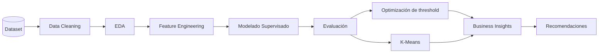

<p align="center">
  
</p>

# 🏦 Bank Churn Prediction

> **Pipeline End-to-End de Machine Learning para predecir el abandono de clientes bancarios y generar estrategias de retención basadas en datos.**

<br>

<p align="center">

📈 **Churn:** 20.4% &nbsp;&nbsp;&nbsp;|&nbsp;&nbsp;&nbsp;
🎯 **Mejor modelo:** Stacking &nbsp;&nbsp;&nbsp;|&nbsp;&nbsp;&nbsp;
📊 **ROC-AUC:** 0.87 &nbsp;&nbsp;&nbsp;|&nbsp;&nbsp;&nbsp;
👥 **Dataset:** 10.000 clientes &nbsp;&nbsp;&nbsp;|&nbsp;&nbsp;&nbsp;
🤖 **Modelos comparados:** 6

</p>

<p>


</p>

---

# 📑 Tabla de contenidos

- [Caso de negocio](#-caso-de-negocio)
- [Objetivos](#-objetivos)
- [Dataset](#-dataset)
- [Estructura del repositorio](#-estructura-del-repositorio)
- [Cómo ejecutar](#-cómo-ejecutar)
- [Metodología](#-metodología)
- [Desarrollo del proyecto](#-desarrollo-del-proyecto)
- [Resultados](#-resultados)
- [Visualizaciones](#-visualizaciones)
- [Competencias demostradas](#-competencias-demostradas)
- [Próximas mejoras](#-próximas-mejoras)
- [Autora](#-autora)

---

# 💼 Caso de negocio

La pérdida de clientes (*Customer Churn*) representa uno de los principales desafíos para las entidades financieras, ya que impacta directamente sobre el **Customer Lifetime Value (CLV)**, los costos de adquisición y la rentabilidad del negocio.

En este proyecto se desarrolló un pipeline completo de Ciencia de Datos para identificar clientes con riesgo de abandono mediante técnicas de Machine Learning supervisado y no supervisado.

Más allá del desempeño predictivo, el objetivo fue transformar los resultados del modelo en **insights accionables** que permitan anticipar acciones de retención y optimizar la toma de decisiones comerciales.

---

# 🎯 Objetivos

- Predecir la probabilidad de abandono de clientes.
- Comparar distintos algoritmos de Machine Learning.
- Identificar las variables con mayor influencia sobre el churn.
- Segmentar clientes mediante técnicas de aprendizaje no supervisado.
- Ajustar el punto de corte del modelo según el costo de negocio.
- Traducir los resultados en recomendaciones accionables para el negocio.

---

# 📂 Dataset

**Fuente:** Kaggle – Bank Customer Churn Dataset (`Data/Churn_Modelling.csv`)

- 👥 10.000 clientes
- 📊 10 variables predictoras
- 🎯 Variable objetivo: **Exited** (1 = el cliente abandonó el banco)
- 🤖 Problema de clasificación binaria, con clases desbalanceadas (20.4% de churn)

Variables principales: `CreditScore`, `Geography`, `Gender`, `Age`, `Tenure`, `Balance`, `NumOfProducts`, `HasCrCard`, `IsActiveMember`, `EstimatedSalary`.

---

# 🗂 Estructura del repositorio

```
Bank-churn-prediction/
├── Data/
│   └── Churn_Modelling.csv                     # Dataset original
├── Notebooks/
│   ├── 1_EDA_RegresionLogistica.ipynb          # EDA y modelo base
│   ├── 2_GradientBoosting_Optimizacion.ipynb   # Modelos de boosting, tuning y Stacking
│   ├── 3_AprendizajeNoSupervisado.ipynb        # Segmentación con K-Means
│   ├── 4_Reporte_Modelos.ipynb                 # Comparación final y reporte PDF
│   └── 5_Optimizacion_Threshold.ipynb          # Punto de corte según costo de negocio
├── Documentación/
│   └── Reporte_Modelos.pdf                     # Reporte ejecutivo
├── Images/
│   └── banner.png
├── requirements.txt
└── README.md
```

---

# 🧪 Cómo ejecutar

```bash
git clone https://github.com/VaninaCavallin/Bank-churn-prediction.git
cd Bank-churn-prediction
pip install -r requirements.txt
jupyter notebook
```

Abrir los notebooks de la carpeta `Notebooks/` en orden numérico (1 → 5). Todos leen el dataset desde `../Data/Churn_Modelling.csv`.

---

# 🔄 Metodología

El proyecto fue desarrollado siguiendo la metodología **CRISP-DM**: comprensión del negocio, comprensión de los datos, preparación, modelado, evaluación y comunicación de resultados.



---

# 🚀 Desarrollo del proyecto

## 1️⃣ Exploración y preparación de datos

Análisis Exploratorio de Datos (EDA), limpieza y preprocesamiento, ingeniería de variables, escalado y codificación de variables categóricas.

**Hallazgos principales**

- La edad incrementa significativamente el riesgo de abandono.
- Los clientes de Alemania presentan mayor probabilidad de churn.
- Un alto balance combinado con baja actividad incrementa el riesgo.
- Los clientes activos presentan menor probabilidad de abandono.

## 2️⃣ Modelado supervisado

Modelos implementados: Logistic Regression, Random Forest, XGBoost, LightGBM, CatBoost y Stacking Classifier.

Técnicas aplicadas: validación cruzada estratificada, optimización de hiperparámetros con **GridSearchCV** y **Optuna**, early stopping y análisis de importancia de variables.

## 3️⃣ Segmentación de clientes

Se aplicó **K-Means** para identificar perfiles de clientes con diferentes características de comportamiento y riesgo de abandono, lo que permitió complementar el modelo predictivo y proponer estrategias diferenciadas de retención.

## 4️⃣ Consolidación y reporte

Se comparó el desempeño de los modelos (Accuracy, Precision, Recall, F1-score, ROC-AUC, PR-AUC y matriz de confusión) y se generó un reporte ejecutivo en PDF.

## 5️⃣ Optimización del punto de corte

Por defecto, un clasificador marca como churn a los clientes con probabilidad ≥ 0.5. Como **no detectar un cliente que se va** (falso negativo) suele costar más que ofrecer un incentivo a quien no lo necesitaba (falso positivo), se evaluó una grilla de umbrales y se eligió el punto de corte según la métrica y el costo de negocio.

---

# 📈 Resultados

Conjunto de prueba (20% de los datos, umbral 0.5):

| Modelo | Accuracy | Precision | Recall | F1 | ROC-AUC | PR-AUC |
|---|---:|---:|---:|---:|---:|---:|
| **Stacking Classifier** | **0.871** | 0.797 | 0.491 | **0.608** | **0.871** | 0.725 |
| CatBoost | **0.871** | 0.802 | 0.486 | 0.606 | **0.871** | **0.726** |
| XGBoost (GridSearch) | 0.869 | 0.790 | 0.482 | 0.598 | 0.870 | 0.722 |
| Random Forest | 0.868 | **0.820** | 0.447 | 0.579 | 0.864 | 0.708 |
| XGBoost (baseline) | 0.869 | 0.780 | 0.496 | 0.607 | 0.861 | 0.711 |
| LightGBM | 0.856 | 0.715 | 0.482 | 0.576 | 0.858 | 0.695 |
| Logistic Regression (balanced) | 0.714 | 0.387 | **0.700** | 0.499 | 0.777 | — |

**Lectura de los resultados**

- Con un 20% de churn, un modelo que predijera siempre "no abandona" ya tendría 80% de accuracy. Por eso las métricas más informativas son **ROC-AUC, PR-AUC, Recall y F1**.
- Los modelos de boosting y el Stacking discriminan bien (ROC-AUC ≈ 0.87), pero con el umbral 0.5 detectan solo la mitad de los clientes que abandonan (Recall ≈ 0.49).
- **Bajar el umbral a 0.30** (Gradient Boosting) sube el Recall de **0.49 a 0.65** y el F1 de **0.61 a 0.64**, a cambio de una precisión menor (0.78 → 0.63). Es decir, se detectan muchos más clientes en riesgo con un costo aceptable en falsos positivos.

---

# 📊 Visualizaciones

## 📈 Curva ROC

<p align="center">

</p>

La curva ROC permite evaluar la capacidad discriminatoria del modelo para distinguir entre clientes que abandonan el banco y aquellos que permanecen. El mejor modelo alcanzó un **ROC-AUC de 0.87**.

## 🎯 Importancia de variables

<p align="center">

</p>

**Age**, **NumOfProducts**, **IsActiveMember** y **Balance** fueron los principales factores asociados al abandono de clientes, información clave para diseñar estrategias de retención focalizadas.

## 🔍 Matriz de confusión

<p align="center">

</p>

La matriz de confusión resume el desempeño del modelo sobre el conjunto de prueba y permite analizar el equilibrio entre falsos positivos y falsos negativos según los objetivos del negocio.

---

# 💼 Competencias demostradas

- Machine Learning End-to-End siguiendo **CRISP-DM**
- Clasificación binaria con clases desbalanceadas
- Aprendizaje supervisado y no supervisado
- Optimización de hiperparámetros y validación cruzada
- Ensambles de modelos (Stacking)
- Ajuste del umbral de decisión según costo de negocio
- Interpretabilidad de modelos y segmentación de clientes
- Storytelling con datos y traducción de métricas técnicas en decisiones de negocio

---

# 🚀 Próximas mejoras

- Implementar seguimiento de experimentos mediante MLflow.
- Desplegar el modelo con Streamlit.
- Automatizar el pipeline de entrenamiento.
- Incorporar monitoreo del modelo.
- Implementar técnicas de Explainable AI (SHAP y LIME).

---

# 👩‍💻 Autora

**Vanina Cavallin**

Dra. en Ciencias Biológicas

**Data Scientist | Data Analyst**

📧 **Email:** vaninacavallin@gmail.com

💼 **LinkedIn:** https://linkedin.com/in/vanina-cavallin
